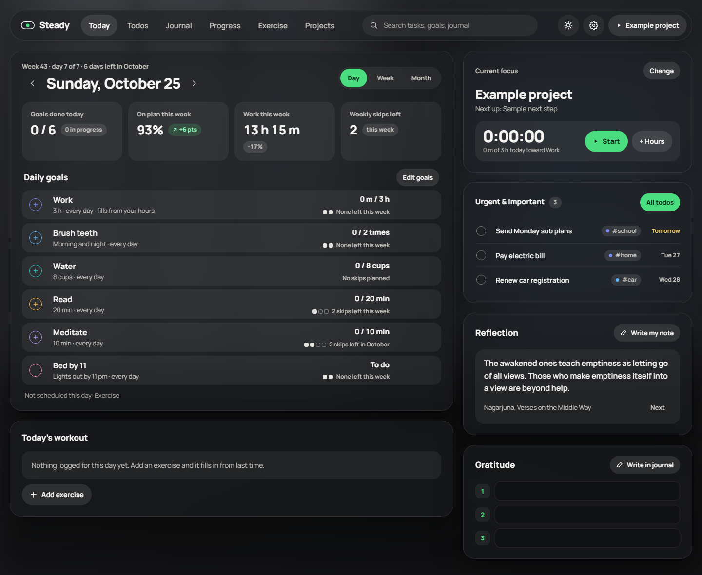
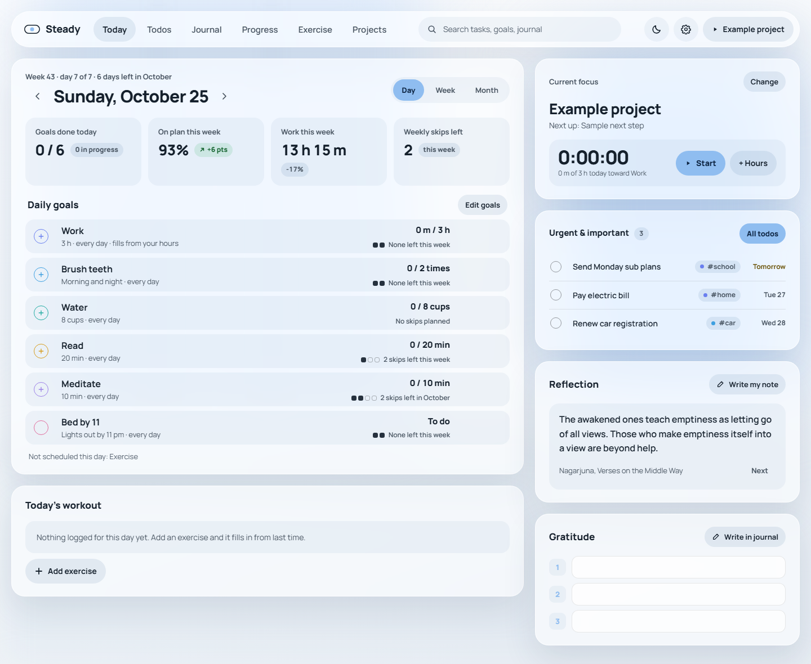
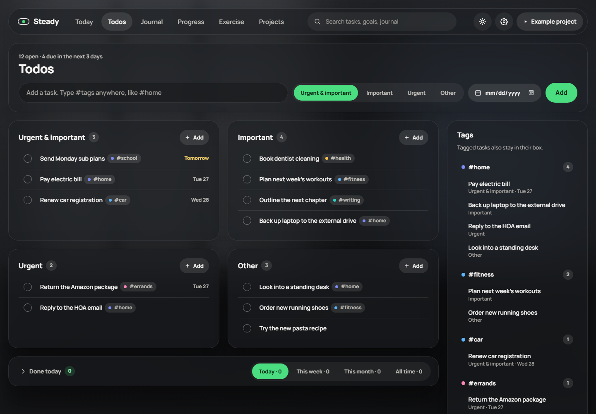
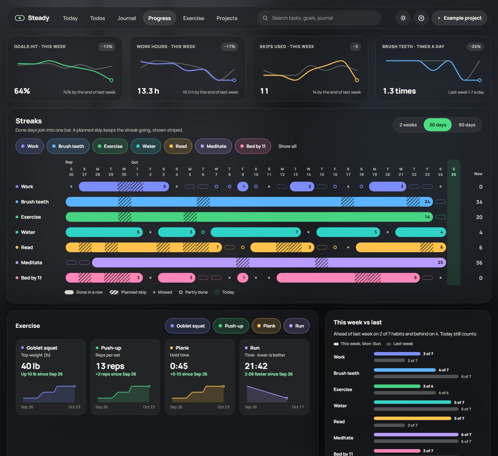
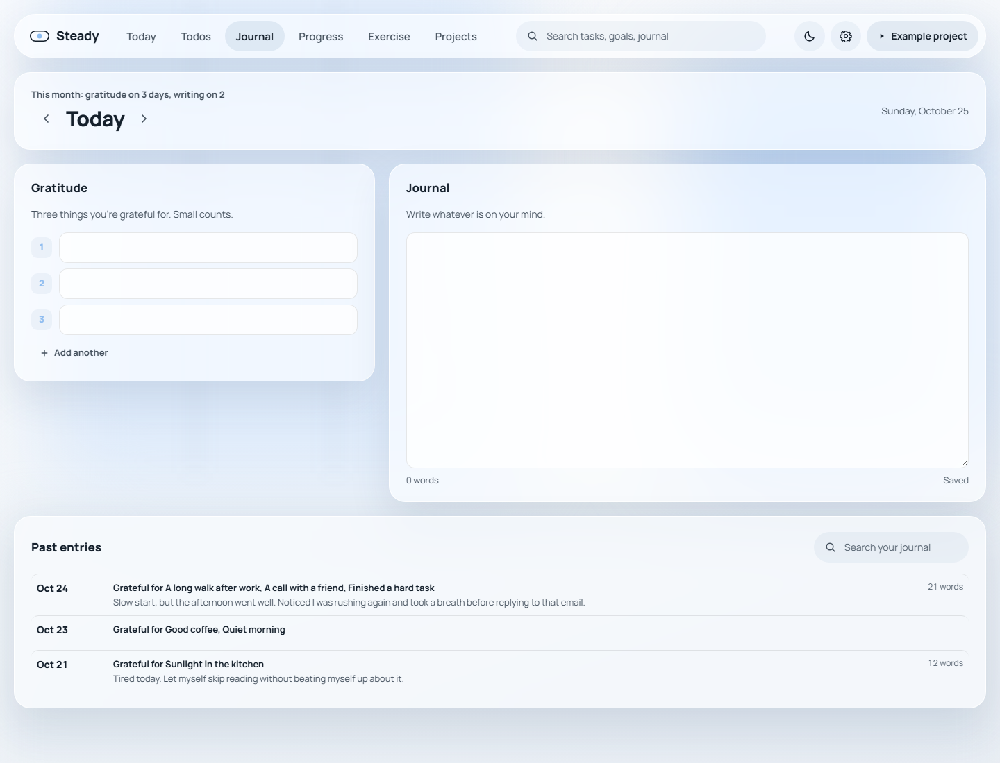

# Steady

A calm, private daily tracker. Daily goals with skip allowances, a focus timer, a workout log,
an Urgent/Important todo grid with #tags, a gratitude journal, and progress charts.
Everything stays on your computer.



## What it does

- **Daily goals that allow for real life.** Check-off goals (brush teeth) or amounts (8 cups, 20 minutes, 3 hours).
  Pick the weekdays a goal applies, and give it skips: "2 days off a week" or "4 a month". A missed day uses a skip;
  when they're gone it simply says so, with no streak resets and no red alarms. Goal rows fill up as you go.
- **Edit any day.** Move back through days, or use the week and month views to fill in what you forgot.
- **Focus and hours.** Pin the project you're focused on, run a timer or add time by hand. Logged time can
  check off a goal like "Work, 3 hours" automatically.
- **Workouts.** Pick a saved exercise and the number of sets, then type reps, weight and time. Steady shows what you
  did last time, and any logged workout can check off an "Exercise" goal.
- **Todos.** Four boxes (Urgent & important, Important, Urgent, Other). Add `#tags` anywhere in a task and it also
  shows up in that tag's area. Optional due dates, drag between boxes, and a done list for today, this week, this month or all time.
- **Journal.** Three things you're grateful for and a page to write on, every day, with search across past entries.
- **Reflection.** A note to yourself that you can open and read each day, and (optional) a daily line from
  classic Zen and non-dual Buddhist texts.
- **Progress.** Trend cards against last week, streak bars where a planned skip keeps the streak going,
  exercise trends, and this week against last.
- **Your look.** Dark and light themes, your own background photo, frosted glass on or off, and panel opacity.

| Light mode | Todos |
| --- | --- |
|  |  |
| **Progress** | **Journal** |
|  |  |

## Privacy

No accounts, no tracking, no network calls. Your data is one JSON file on your computer, saved as you go,
with a copy kept from each of the last 30 days. Settings › Data lets you export a backup or import one.

| System | Where your data lives |
| --- | --- |
| Windows | `%APPDATA%\Steady\steady-data.json` |
| macOS | `~/Library/Application Support/Steady/steady-data.json` |
| Linux | `~/.local/share/Steady/steady-data.json` |

## Getting started

You'll need [Python 3](https://www.python.org/downloads/) (to run Steady) and [Node.js](https://nodejs.org/) 20 or newer (to build it once).

```bash
git clone https://github.com/0thdimension/steady.git
cd steady
npm install
npm run start
```

`npm run start` builds the app and opens it in its own window. On Windows that's a Microsoft Edge app window;
elsewhere it opens in your default browser. Close the window when you're done; the small helper behind it stops on its own.

**Windows shortcut:** after building, run `npm run portable`. It makes `portable/Steady`, a folder that needs only Python.
Put it somewhere it can stay and double-click **Set up Steady.pyw** to get a Desktop and Start menu shortcut.

**Just looking?** Run `npm run dev` and open `http://localhost:5287/?demo` to see six weeks of sample data.
Demo mode never saves anything. In plain `npm run dev` mode (without `?demo`) your data is kept in that browser's storage.

## Development

```bash
npm run dev        # http://localhost:5287
npm test           # day, skip-allowance, streak, tag and chart tests
npm run build      # type-checks, then builds dist/ (what the launcher serves)
```

Built with React, TypeScript, Vite and Zustand, plus a small Python launcher (`launcher/steady.pyw`)
that serves `dist/` on `127.0.0.1` behind a per-launch access key and keeps the data file.

- `src/data/` the data model, the day and skip-allowance rules (`logic.ts`), dates, quotes, saving
- `src/screens/` Today, Todos, Journal, Progress, Exercise, Projects, Settings
- `src/components/` the nav, shared UI, charts, the workout log, the journal and goal editors
- `launcher/` the launcher and the Windows shortcut setup
- `tests/` logic and chart tests

## About the quotes

The daily lines are plain-English renderings of classic texts (the Heart and Diamond Sutras, Nagarjuna, Sengcan,
Huineng, Dogen, Tilopa, Saraha and others), written for this app rather than copied from any one translation.
You can turn them off in Settings › Appearance.

## License

[MIT](LICENSE)
